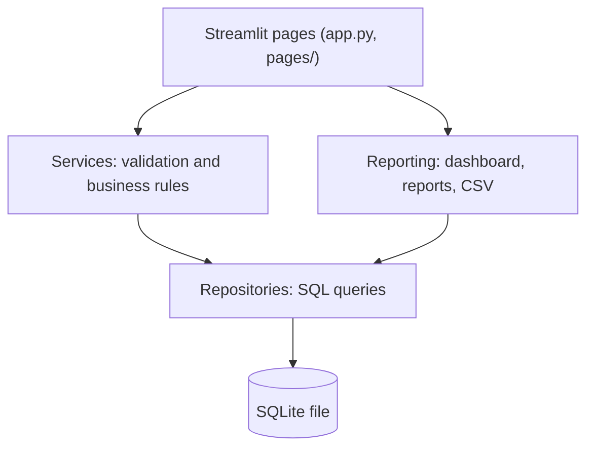

# Textile Dyeing Intelligence

A local record-keeping and analysis tool for textile dyeing batches. It keeps batch, recipe, chemical, quality and rework records in one place and shows where they differ from the plan.

## Overview

Textile Dyeing Intelligence runs on a single computer. Staff enter what was planned and what actually happened in each dyeing batch. The tool compares planned and actual chemical use, tracks quality inspections and rework, and produces dashboard figures and CSV reports.

It is a records and reporting tool. It does not control machines, read sensors or predict results.

## The problem

In many dyehouses, batch information is spread across paper job cards, spreadsheets and memory. This makes simple questions hard to answer:

- Which recipe revision was used for this batch?
- How much dye or salt was planned, and how much was actually used?
- Which batches failed inspection, and were they reworked?
- Which machine ran which batches?

When records are scattered, differences between planned and actual use go unnoticed. Repeat quality problems are harder to trace. A recipe that was edited after use makes old batches hard to explain.

## The solution

The tool gives each batch one record and links everything else to it:

- the recipe revision and machine used,
- process observations such as temperature or pH,
- planned and actual chemical quantities,
- every quality inspection and any rework.

Old records are protected. A recipe revision cannot be changed once a batch uses it. A passed or failed inspection cannot be edited. Corrections are made by adding new records, so the history stays visible.

The tool never guesses. If a value is missing, it shows "Not recorded". If a figure cannot be calculated, it shows "Unavailable" and does not fill in a number.

## Key capabilities

- Batches: create, edit and search batches. Status moves from planned to in progress to completed or cancelled. Completed and cancelled batches lock their quantity, recipe revision and machine.
- Recipes: store recipes as numbered revisions with ingredient quantities. Revisions used by a batch are locked.
- Machines: keep a list of machines with a manually recorded status (available, unavailable, maintenance).
- Process records: enter observations (parameter, value, unit, time). Corrections keep a history.
- Chemical consumption: record planned and actual quantities per material. The tool calculates the difference and the percentage difference.
- Quality inspections: record inspections as pending, passed or failed, with defects and measurements. Several inspections per batch are kept.
- Rework: record rework linked to a batch and, optionally, an inspection. Track it from required to in progress to completed.
- Dashboard: batch counts by status, failure rate, rework rate, batches awaiting a quality outcome and consumption comparison counts. It supports date, machine, recipe and status filters.
- Reports with CSV export: batch production, consumption comparison, consumption records, quality, rework and machine activity.
- Sample data: an optional synthetic data set for trying the tool.
- Backup and restore: command-line scripts.

## How it works

1. Set up machines and recipes. Add each recipe as a revision with its ingredients.
2. Create a batch. Choose the recipe revision, machine, quantity and planned date.
3. Start the batch and record process observations while it runs.
4. Enter planned and actual chemical quantities.
5. Complete the batch and record the quality inspection. If it fails, record rework and the follow-up inspection.
6. Use the dashboard and reports to review results. Download CSV files if needed.

| Input | Process | Output |
| --- | --- | --- |
| Entries typed in the forms | Checks values, applies status rules, saves in one step | Batch history, consumption differences, quality and rework figures |

### How the figures are calculated

- Consumption difference = actual − planned. Percentage difference = (actual − planned) ÷ planned × 100.
- A difference is "Unavailable" when planned is zero, a value is missing, or the units or basis differ. The tool does not convert units. Use the same unit for planned and actual.
- Final quality outcome of a batch = its latest passed or failed inspection. Pending inspections are ignored. A batch with no inspection is not counted as passed.
- Failure rate = batches whose final outcome is failed ÷ batches that have a final outcome.
- Rework rate = batches with at least one non-cancelled rework record ÷ non-cancelled batches. Rework events are also shown as a separate count.
- Batch date used for filters = actual start date, otherwise planned date, otherwise creation date.

The tool does not set quality thresholds or recipes. It only reports what users record.

## System architecture

The code is split into layers. Each layer only talks to the one below it.



- Pages show forms and tables and contain no business rules.
- Services check input with Pydantic models, enforce status rules and run each save as one database transaction.
- Repositories hold the SQL.
- Reporting builds dashboard figures and report tables from the same filters.
- SQLite stores the data. Foreign keys are enforced. Triggers protect used recipe revisions and finalised inspections. Unique indexes reject accidental duplicate submissions.
- Quantities are stored as exact decimal text and calculated with Python `Decimal`, not floating point.
- The schema version is kept in `PRAGMA user_version`.

## Technology stack

| Technology | Use |
| --- | --- |
| Python 3.11 or newer | Application language. Tested on 3.13. |
| Streamlit 1.66.0 | Browser interface |
| SQLite (Python standard library `sqlite3`) | Local database |
| Pydantic 2.13.5 | Input validation |
| pytest 9.1.1 | Tests (development only) |
| Ruff 0.17.1 | Linting and formatting (development only) |

All are free and open source.

## Installation and setup

### Prerequisites

- Python 3.11 or newer (check with `py --version` on Windows)
- Internet access for the first install

### Windows (Command Prompt)

```
cd path\to\textile-dyeing-intelligence
py -m venv .venv
.venv\Scripts\activate.bat
python -m pip install --upgrade pip
pip install -r requirements.txt
streamlit run app.py
```

The app opens at `http://localhost:8501`. Press `Ctrl+C` in the window to stop it. Next time, run only the `activate.bat` and `streamlit run` lines.

### Linux or macOS

```
python3 -m venv .venv
source .venv/bin/activate
pip install -r requirements.txt
streamlit run app.py
```

### Database location

The database file is created on first start.

- Windows: `%LOCALAPPDATA%\TextileDyeingIntelligence\textile_dyeing.db`
- Other systems: `~/.local/share/textile-dyeing-intelligence/textile_dyeing.db`

To use another file, set `TDI_DB_PATH` before starting the app:

```
set TDI_DB_PATH=C:\data\my_dyeing.db
streamlit run app.py
```

Streamlit settings are in `.streamlit/config.toml`. The app is set to listen on localhost only.

## Usage

Use the sidebar to open each page. Fields marked with * are required. A form that is saved successfully clears itself. An invalid form shows what to correct and saves nothing.

A suggested order for first use: Machines, Recipes, Batches, then Process Records, Chemical Consumption, Quality Inspections and Rework. Dashboard and Reports can be opened at any time.

### Try it with sample data

Sample data is synthetic. Every identifier starts with `SYN-`. It is not real factory data. Load it into a separate demo database:

```
set TDI_DB_PATH=demo.db
python scripts\load_sample_data.py --db demo.db
streamlit run app.py
```

Remove only the sample records:

```
python scripts\load_sample_data.py --db demo.db --remove
```

The loader refuses to run twice and refuses to add into a database that already holds real records. See [sample_data/README.md](sample_data/README.md).

### Backup and restore

Stop the app before restoring.

```
python scripts\backup_db.py --out backups\backup1.db
python scripts\restore_db.py backups\backup1.db
```

Both scripts use the default database unless `--db PATH` is given. A backup is checked after it is created. Restore checks the backup first and keeps the old database as `<name>.pre-restore-<timestamp>`. To create the database without starting the app, run `python scripts\init_db.py`.

### CSV export

The Reports page offers a CSV download for each report. Files are UTF-8 with a byte order mark so Excel opens them correctly. Text cells that start with `=`, `+`, `-` or `@` get a leading `'` so spreadsheets do not run them as formulas.

## Project structure

```
app.py                  Dashboard and page navigation
pages/                  One file per page (Batches, Recipes, Machines, ...)
src/textile_dyeing_intelligence/
    services/           Validation and business rules
    repositories/       SQL queries
    reporting/          Dashboard figures, reports, CSV export
    schema.py           Database schema, triggers and migrations
    database.py         Connections, transactions, backup and restore
    validation.py       Pydantic input models
    sample_data.py      Synthetic data loader
scripts/                init_db, load_sample_data, backup_db, restore_db
sample_data/            Notes on the synthetic data
tests/                  Unit and integration tests
```

### Tests and linting

```
pip install -r requirements-dev.txt
python -m pytest
python -m ruff check .
```

## Current status

Version 0.1.0. All features listed above are implemented.

Verified so far:

- 155 automated tests passed on Linux with Python 3.13.
- Every page loads with an empty and a sample database in headless Streamlit tests.
- The server started and answered its health check on Linux.
- Backup and restore ran successfully on Linux.

Not yet verified:

- Running on Windows or on Python 3.11 and 3.12.
- Real factory use. The tool has not been validated with real production data.

Limits to know about:

- Single user, no login and no database encryption. Run it on a trusted computer and do not expose it to a network.
- Data is entered by hand. There is no import, machine connection or unit conversion.
- The interface is in English.

## Roadmap

These are ideas, not implemented features:

- Test and document use on Windows and on more Python versions.
- Import of existing batch records from CSV files.
- Optional user accounts for shared use.
- Unit conversion with explicit, user-defined rules.

## Contributing

1. Fork the repository and create a branch.
2. Install the development dependencies and run `python -m pytest` and `python -m ruff check .`.
3. Keep changes small and add tests for new behaviour.
4. Do not commit real production data, `.db` files or credentials.
5. Open a pull request that describes what changed and why.

## License

MIT. Copyright Vipin T K. See [LICENSE](LICENSE).
